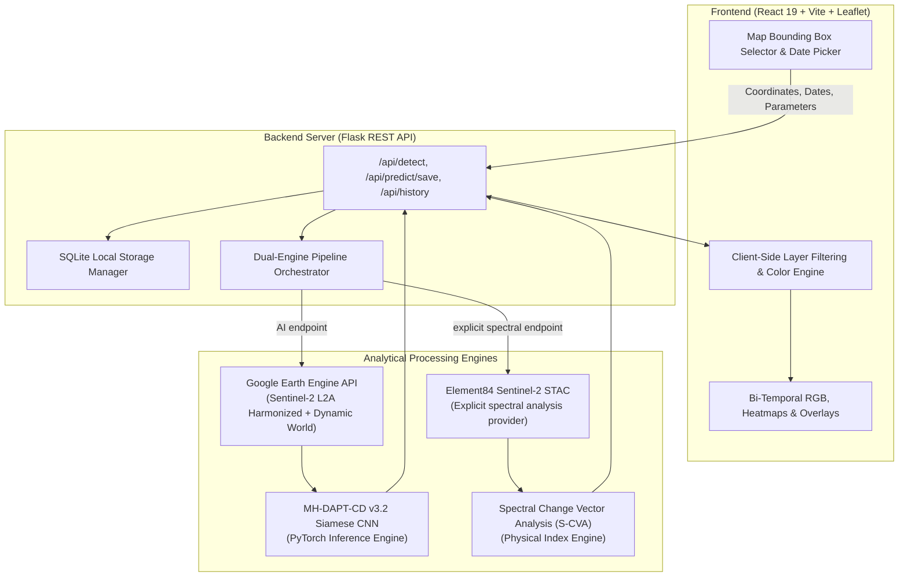

# Geo-Nexus: Dual-Engine Satellite Change Detection & Multi-Spectral Dynamics

[](https://www.python.org/)
[](https://pytorch.org/)
[](https://react.dev/)
[](https://vitejs.dev/)
[](https://flask.palletsprojects.com/)
[](https://earthengine.google.com/)
[](https://sentinels.copernicus.eu/)
[](https://git-lfs.com/)
[](https://opensource.org/licenses/MIT)

**Geo-Nexus** is an enterprise-grade, cloud-native satellite change detection and environmental monitoring platform. It combines deep learning bi-temporal Siamese feature representations with physics-based multispectral remote sensing indices to detect, categorize, and quantify land-cover transformations at a 10-meter ground resolution using Sentinel-2 and Google Earth Engine (GEE).

---

## Live AI acquisition requirements and troubleshooting

Geo-Nexus AI at `/api/detect/start` requires a configured Earth Engine project and a compatible real Sentinel-2 plus Sentinel-1 pair. Its unchanged 17-channel contract is B2–B12, NDVI, NDBI, VV, VH, VH_VV, and trained Q. Spectral Index Analysis (S-CVA) is an independent method at `/api/detect/spectral/start`; Sentinel-2 STAC can supply it, but it is never substituted for neural inference.

For AI, each bbox dimension must cover at least 128 nominal 10 m pixels (1.28 km); an undersized selection is rejected before Earth Engine is queried. For arbitrary AOIs the backend queries descending IW VV/VH scenes independently in both date windows and chooses one shared relative orbit. Only the exact Pune, Satara, and Vidarbha benchmark extents retain their frozen research orbits, which are never replaced if unavailable. Earth Engine initialization success does not guarantee that a particular collection, metadata query, quality product, or imagery download is available.

From `Backend/`, investigate the current Sentinel-1 metadata path with the same `.env` and Python environment used for Flask:

```powershell
python diagnostics/test_s1_orbit_query.py --t1 2021-03-15 --t2 2024-03-15 --window-days 15 --max-cloud 30 --bbox 72.8432 19.1113 72.8527 19.1203
```

The tool reports each failing operation and never downloads rasters or runs inference. Query errors (for example `s1_t1_orbit_histogram`) must be resolved as API/auth/access failures; they do not mean the orbit set is empty. `gee_s1_no_scenes_t1/t2` means that date query succeeded but found no eligible scenes. `gee_no_common_s1_orbit` means both orbit queries succeeded but their sets do not overlap. Widen the time window explicitly or choose other dates. For `area_too_small`, enlarge the selected bounds; do not resample a small AOI to imitate 10 m coverage.

The backend reports its non-secret build identifier in startup logs and `/api/health`. A local Git build includes a `-dirty` suffix when files are modified; set `GEONEXUS_BUILD_ID` for deployments without local Git metadata. Backend credentials remain local and are not shown in health output.

Run automated checks from the project folders:

```powershell
cd Backend
python -m unittest discover -s tests -p test_reliability_contracts.py -v
cd ..\Frontend
npm ci
npm run test
npm run lint
npm run build
```

Mocked tests verify request handling, orbit-query stages, engine identity, and the model contract. They do not validate live imagery or Earth Engine access. The live diagnostic requires Earth Engine credentials visible to the Python interpreter running it.

---

## Key Highlights

- **Dual-Engine Analytical Framework**:
  - **Primary AI model (MH-DAPT-CD v3.2)**: Siamese ResNet with multi-spectral `SplitStem`, cross-temporal difference fusion, and attention decoders trained via DAPT and few-shot adaptation ($k=30$). Live inference requires Sentinel-2 plus real Sentinel-1 features from Google Earth Engine.
  - **Explicit spectral diagnostic (S-CVA)**: Independent optical-index change-vector analysis ($\Delta\text{NDVI}$, $\Delta\text{NDBI}$, $\Delta\text{NDWI}$, $\Delta\text{BSI}$) with spatial filtering. It does not use the neural model.
- **Categorical Surface Dynamics & Interactive Filtering**:
  - 🏗️ **Urban & Structural Changes** (`#eab308` Yellow): Built-up expansion, infrastructure developments, high-albedo transitions.
  - 🌾 **Soil & Agricultural Dynamics** (`#f97316` Orange): Fallow fields, harvest cycles, bare soil exposure.
  - 🌿 **Vegetation Canopy Shifts** (`#22c55e` Green): Reforestation, seasonal biomass canopy bloom, deforestation.
  - 💧 **Water & Hydrological Fluctuations** (`#2563eb` Blue): Reservoir level shifts, wetlands, flood delineation.
- **Interactive Geospatial Frontend**:
  - Built with React 19, Vite, and Leaflet.
  - Interactive bounding box drawer with real-time ground distance, aspect ratio, and area calculation ($m^2$ / hectares).
  - Client-side layer filtering allowing instant toggling of individual surface dynamic categories without re-fetching.
  - Split-screen comparison, opacity sliders, and geocoded location search.
- **Persistent Prediction History**:
  - Completed results are stored in SQLite. Sentinel-2 STAC supports the spectral method without GEE; AI analysis reports a clear input error if real Sentinel-1 features are unavailable.

---

## System Architecture



---

## Directory Structure

```
Major Project/
├── Backend/
│   ├── Model/
│   │   └── geonexus_v3_2_k30/          # Production PyTorch weights (mh_fewshot_best_k30.pth)
│   ├── storage/
│   │   ├── geonexus_predictions.db     # Pre-seeded SQLite database with cached runs
│   │   └── .gitkeep
│   ├── tests/                          # Automated backend & engine verification tests
│   ├── app.py                          # Main Flask application & REST endpoints
│   ├── gee_service.py                  # Google Earth Engine acquisition & S-CVA pipeline
│   ├── inference.py                    # MH-DAPT-CD PyTorch inference module
│   ├── sentinel_stac_service.py        # STAC fallback provider
│   ├── spectral_cd.py                  # Multi-spectral index mathematics
│   ├── storage_manager.py              # SQLite caching layer
│   ├── requirements.txt                # Python dependencies
│   ├── .env.example                    # Backend environment template
│   └── README.md                       # Backend-specific documentation
├── Frontend/
│   ├── src/
│   │   ├── components/                 # React components (LocationMap, ResultsPanel, Header)
│   │   ├── context/                    # State management
│   │   ├── services/                   # Axios API services
│   │   ├── App.jsx                     # Top-level application layout
│   │   └── main.jsx                    # React 19 entrypoint
│   ├── package.json                    # Node dependencies
│   ├── vite.config.js                  # Vite configuration
│   ├── .env.example                    # Frontend environment template
│   └── README.md                       # Frontend-specific documentation
├── Model_Training/
│   ├── data/
│   │   ├── gee/                        # Earth Engine export scripts
│   │   ├── oscd_geonexus_pipeline/     # Benchmark preprocessing & validation
│   │   └── weights/                    # Foundation weight staging
│   ├── models/
│   │   └── stem.py                     # SplitStem optical + SAR stem
│   ├── notebooks/                      # Jupyter research & training notebooks
│   ├── FINAL_ARCH_3.md                 # Complete model architecture specifications
│   ├── progress.md                     # Training logs & experimental audit
│   └── README.md                       # Training pipeline guide
├── .gitattributes                      # Git LFS tracking rules (*.pth)
├── .gitignore                          # Strict ignore rules (datasets, credentials, caches)
├── project.ipynb                       # Evaluation & visualization notebook
└── README.md                           # Flagship project documentation
```

---

## Getting Started

### Prerequisites

- **Python**: Version 3.10 or 3.11
- **Node.js**: Version 18 or higher (with `npm`)
- **Git & Git LFS**: Ensure Git Large File Storage is installed (`git lfs --version`)
- **Google Earth Engine Account and project**: Required for live AI inference because its model contract includes real Sentinel-1 features. Sentinel-2 STAC is available to the separately selected spectral method; AI does not fall back to STAC.

---

### Step 1: Clone the Repository & Pull LFS Weights

```bash
git clone https://github.com/your-username/geo-nexus.git
cd geo-nexus

# Ensure Git LFS pulls the 96.5 MB model checkpoint
git lfs install
git lfs pull
```

---

### Step 2: Backend Setup

1. Open a terminal and navigate to `Backend/`:
   ```bash
   cd Backend
   ```

2. Create and activate a Python virtual environment:
   ```bash
   # Windows PowerShell
   python -m venv venv
   .\venv\Scripts\Activate.ps1

   # Linux / macOS
   python3 -m venv venv
   source venv/bin/activate
   ```

3. Install required packages:
   ```bash
   pip install -r requirements.txt
   ```

4. Configure environment variables:
   ```bash
   cp .env.example .env
   ```
   For the primary AI method, authenticate the same local Earth Engine account used by the backend and set a valid GCP Project ID in `.env`. A placeholder project ID or missing credentials leaves AI unavailable; the separate spectral method can still use Sentinel-2 STAC:
   ```bash
   earthengine authenticate
   ```

5. Launch the Flask API server:
   ```bash
   python app.py
   ```
   The backend will start at **`http://localhost:5000`**. Health check: `http://localhost:5000/api/health`.

---

### Step 3: Frontend Setup

1. Open a new terminal and navigate to `Frontend/`:
   ```bash
   cd Frontend
   ```

2. Install dependencies:
   ```bash
   npm install
   ```

3. Configure environment variables:
   ```bash
   cp .env.example .env
   ```

4. Start the Vite development server:
   ```bash
   npm run dev
   ```
   The frontend will be available at **`http://localhost:5173`**.

---

## Running Change Detection

1. **Open the Web Interface**: Navigate to `http://localhost:5173` in your browser.
2. **Select a Target Area**:
   - Use the search bar to locate an area of interest (e.g., *"Navi Mumbai"*, *"Pune"*, or *"Dhule"*).
   - Click and drag on the map or use the rectangle tool to draw your bounding box.
3. **Configure Temporal Windows**:
   - Choose **Date T1 (Before)** and **Date T2 (After)**.
   - Adjust cloud coverage tolerance (default 30%) and temporal search radius. The AI bbox must be at least 1.28 km in both dimensions at nominal 10 m resolution.
4. **Execute Detection**:
   - Click **Run Geo-Nexus AI Analysis** for the trained model. Spectral Index Analysis (S-CVA) is available as an explicit alternative in Advanced Analysis.
   - If using cached regions, results will load instantly.
   - If a live GEE query fails, open **Acquisition diagnostics** and use its reported operation, stage, and request ID to troubleshoot. Initialization success does not guarantee that every collection query or date window is available.
5. **Explore & Filter Results**:
   - Inspect the **Change Heatmap** and **Confidence Distribution**.
   - Use the **T2 Overlap Mask** with individual category checkboxes to isolate:
     - 🏗️ *Urban & Structural expansion*
     - 🌾 *Soil & Agricultural turnover*
     - 🌿 *Vegetation changes*
     - 💧 *Water dynamics*
   - Save the prediction to local history for one-click reloads.

---

## Machine Learning Pipeline & Model Checkpoints

The deep learning model **MH-DAPT-CD v3.2** was trained through a 4-phase protocol:

1. **Phase 1: Foundation Pretraining**: Self-supervised representation learning on SSL4EO-S12 (Sentinel-1 and Sentinel-2 multi-sensor pairings).
2. **Phase 2: Domain-Adaptive Pre-Training (DAPT)**: Unsupervised temporal alignment across Maharashtra biogeographical zones (Western Ghats, Deccan Plateau, Vidarbha).
3. **Phase 3: Supervised Transfer**: Baseline transfer learning on the Onera Satellite Change Detection (OSCD) benchmark.
4. **Phase 4: Target Few-Shot Adaptation**: Calibrated adaptation on high-confidence regional ground-truth clusters ($k \in \{2, 3, 5, 10, 20, 30\}$), with $k=30$ achieving optimal precision-recall balance.

- **Kaggle Checkpoints & Artifacts**:
  Model weights and intermediate validation checkpoints are hosted at:  
  [Kaggle: `sumit07125/geonexus-p4b-v6-model-artifacts`](https://www.kaggle.com/datasets/sumit07125/geonexus-p4b-v6-model-artifacts)

---

## API Reference

| Endpoint | Method | Description |
|---|---|---|
| `/api/health` | `GET` | Health check and engine readiness diagnostic. |
| `/api/detect/start` | `POST` | Starts Geo-Nexus AI analysis (requires real SAR model inputs). |
| `/api/detect/spectral/start` | `POST` | Starts explicit Spectral Index Analysis (S-CVA), without the neural model. |
| `/api/detect/status/<job_id>` | `GET` | Retrieves job progress, result, or structured error. |
| `/api/predictions` | `GET` / `POST` | Lists or saves engine-labeled SQLite history. |
| `/api/predictions/<id>` | `GET` / `DELETE` | Reads or removes one saved prediction. |
| `/api/predictions/match` | `POST` | Matches a saved result by engine, bbox, and dates. |

---

## License

This project is licensed under the **MIT License** — see the [LICENSE](LICENSE) file for details.

## Acknowledgements

- **European Space Agency (ESA)** for Copernicus Sentinel-2 satellite imagery.
- **Google Earth Engine Team** for high-performance planetary-scale geospatial processing APIs.
- **World Resources Institute & Google** for the Dynamic World real-time land cover dataset.
- **IAPR-TC7 / IEEE DataPort** for the Onera Satellite Change Detection (OSCD) benchmark.
